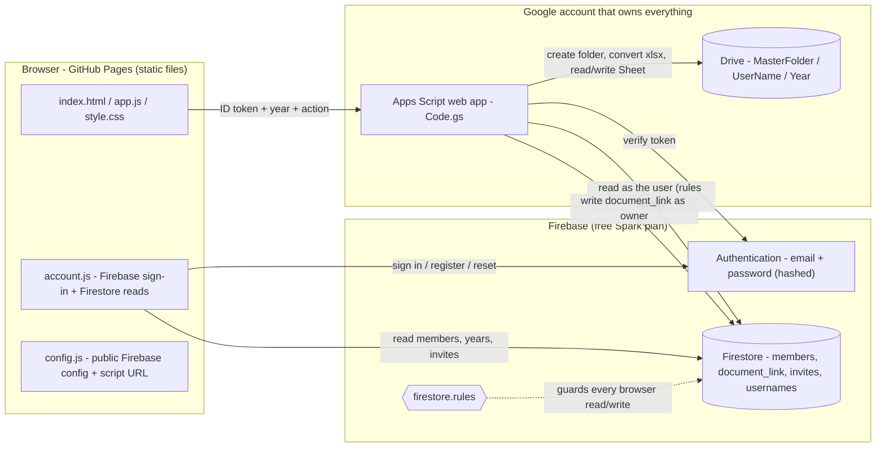
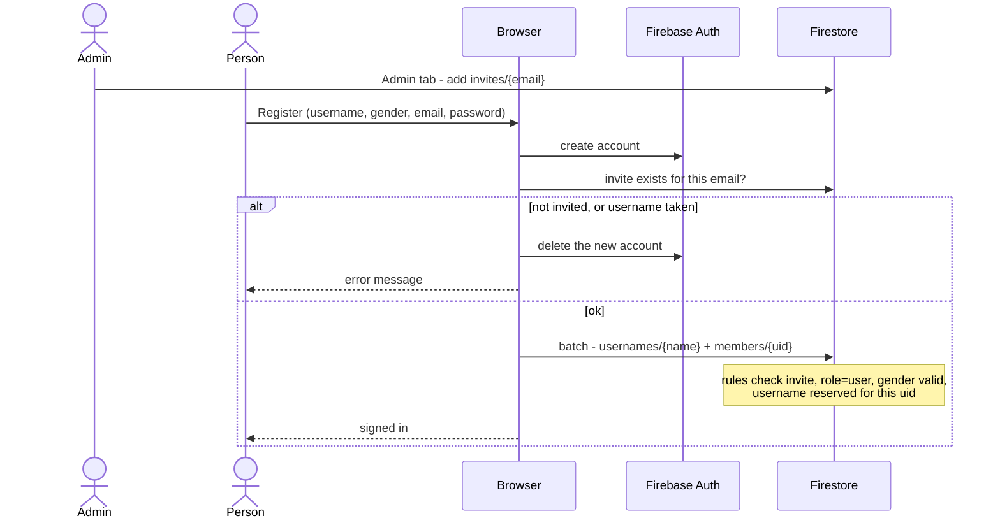
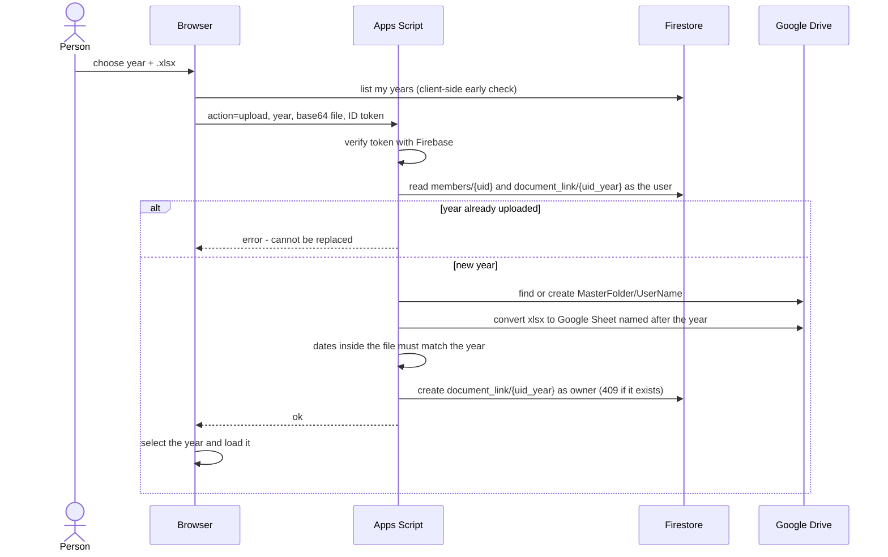
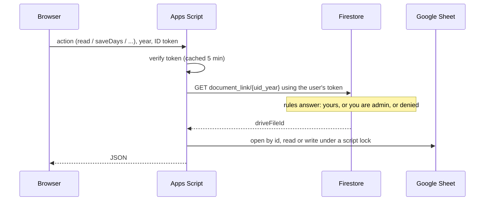
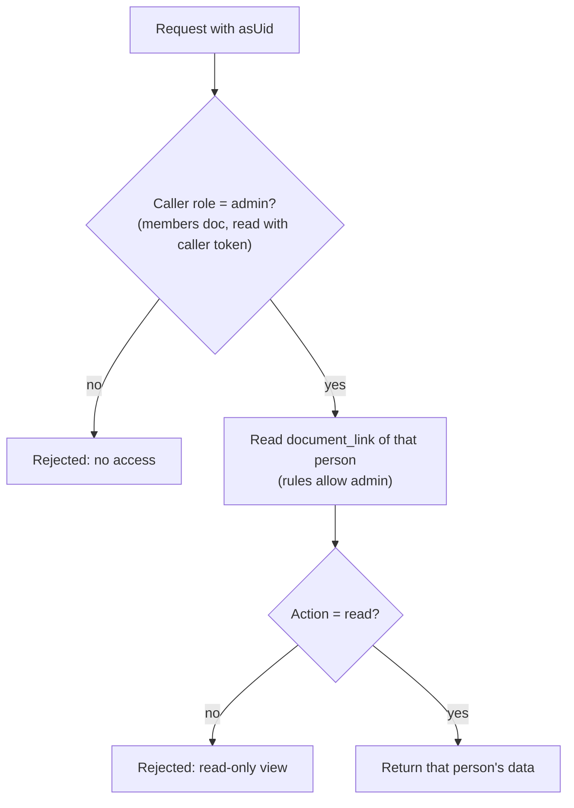
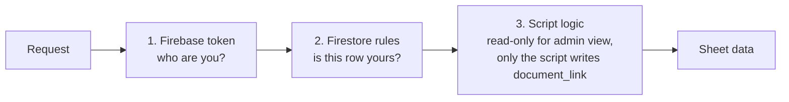

# Architecture

## 1. The big picture

Three Google services do the work; the site itself is only static files.

**Key idea:** the browser never sends a file link. It sends *who it is* (a Firebase token) and *which year*. The script finds the file itself.

## 2. Sign-in and registration (invite only)

Passwords are stored only by Firebase Authentication. Admin status is set by hand in the Firestore console (`members/{uid}.role = "admin"`); the site cannot grant it.

## 3. Upload a year

If anything fails after the Sheet is created, the script moves that Sheet to the trash so no orphan files are left.

## 4. Viewing and saving a tracker

## 5. Admin viewing someone else

The admin picks a person in the header. The browser adds `asUid` to the request.

The browser also disables editing in this view, but the real enforcement is in the script.

## 6. Three layers of protection

## 7. File map

| File | Role |
|---|---|
| `index.html`, `style.css` | Pages, sign-in screen, layout and theme |
| `app.js` | UI logic: tabs, tracking, buy list, analysis, upload, admin |
| `account.js` | Wraps Firebase Auth and Firestore; the only code that touches Firebase |
| `config.js` | Public Firebase config and the Apps Script URL (safe to commit) |
| `Code.gs` | Apps Script: token check, Drive upload, Sheet read/write |
| `appsscript.json` | Script manifest: Drive v3 service, permission scopes, web-app access |
| `firestore.rules` | Security rules, pasted into the Firebase console |

## 8. Limits and design trade-offs

- **One script lock:** Apps Script serialises requests with a lock, which is fine for a handful of users; many simultaneous users would queue.
- **Apps Script quotas:** daily limits apply to Drive and URL fetch calls. Fine for a few users.
- **Upload size:** about 10 MB per file; the file travels as base64 in one request.
- **Token cache:** verified tokens are cached for 5 minutes to save a round trip; a removed account can still act for up to 5 minutes.
- **Public config:** the Firebase `apiKey` in `config.js` is public by design; protection comes from the rules and the script.
