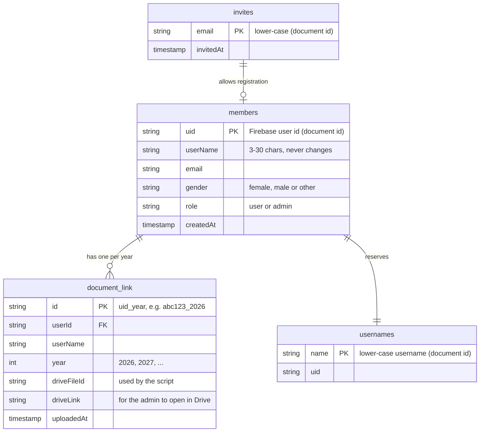

# Data model and security

## Firestore collections

| Collection | Written by | Notes |
|---|---|---|
| `members` | The person, once, at registration | The "Member" table. **No password** - Firebase Authentication stores it, hashed. Never updated afterwards. |
| `document_link` | **Apps Script only** | The fact table. The id `<uid>_<year>` makes a second upload of the same year impossible. |
| `invites` | Admin | Only invited emails can register. |
| `usernames` | The person, at registration | Reserves a lower-case name so two people cannot share one. Never changed or released. |

## What each role can do

| Action | Person | Admin |
|---|---|---|
| Register | Only with an invite | Same |
| Read own `members` row / years | Yes | Yes |
| Read others' `members` / years | No | Yes |
| Read others' Sheet data | No | Yes, **read-only** |
| Upload a year | Yes, once per year | Yes (own account) |
| Create / edit `document_link` from the browser | No | No (only the script can) |
| Delete a `document_link` row (so a year can be re-uploaded) | No | Yes |
| Manage invites | No | Yes |
| Change username, gender, role | No | Only by hand in the Firebase console |

## Security notes

- **The browser never names a file.** Requests carry a Firebase token and a year. The script reads that person's `document_link` row using *their* token, so Firestore rules decide access. Even a modified browser cannot open another person's file.
- **Only the script writes `document_link`.** If browsers could, a user could write a row pointing at someone else's `driveFileId`. The rules deny all client creates and updates; the script writes with the project owner's Google permissions.
- **Role cannot be self-assigned.** Registration is only accepted with `role = "user"`.
- **Existence checks.** Reading a `document_link` row that does not exist yet answers "not found" (decided by the id), not "denied", which is what makes the first upload of a year work.
- **Public values.** `config.js` holds the Firebase web config, which is public by design.
- **Drive privacy.** Files are private to the owner's Google account; people reach them only through the site.
- **Unknown logins.** Anyone who finds the public API key could create a Firebase login, but without an invite they get no `members` row and so no access. Delete such logins in Authentication → Users.

## Changing the rules

`firestore.rules` in the repo is the source of truth, but Firebase only uses what is pasted into **Firestore → Rules → Publish**. After editing the file, paste and publish it again.
